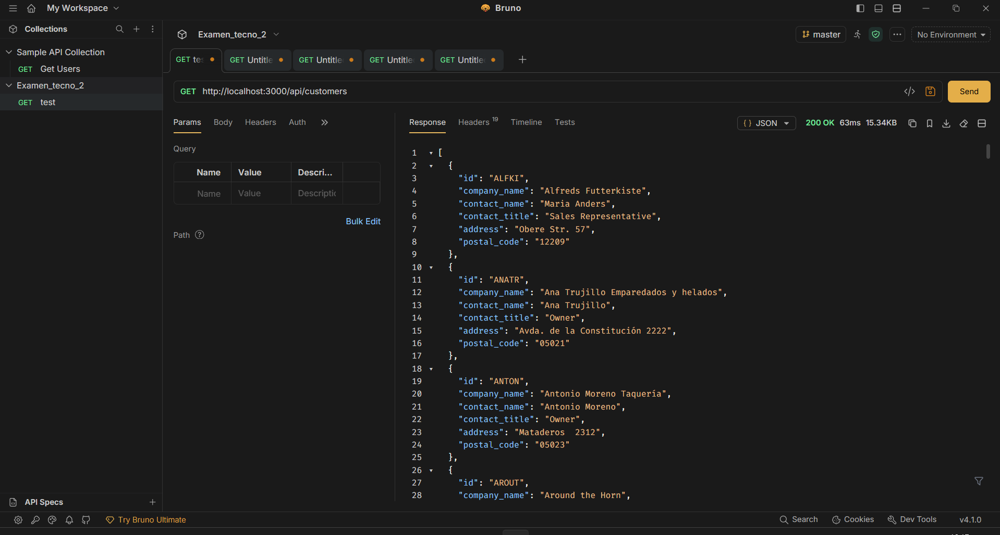
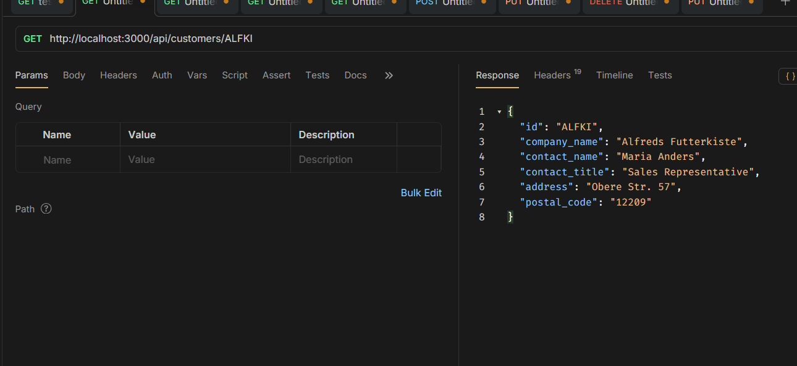
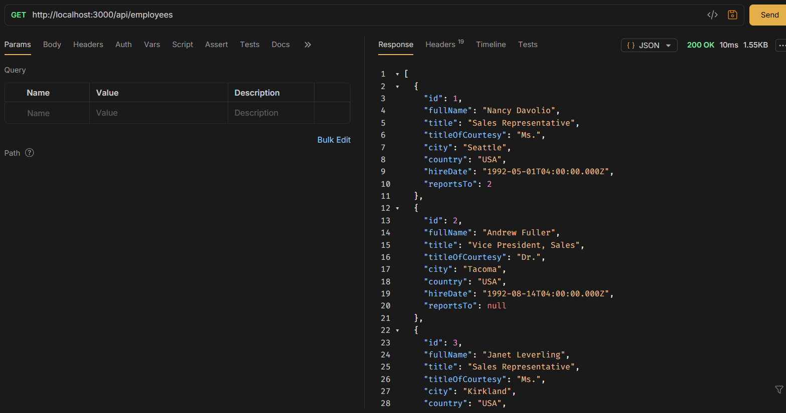
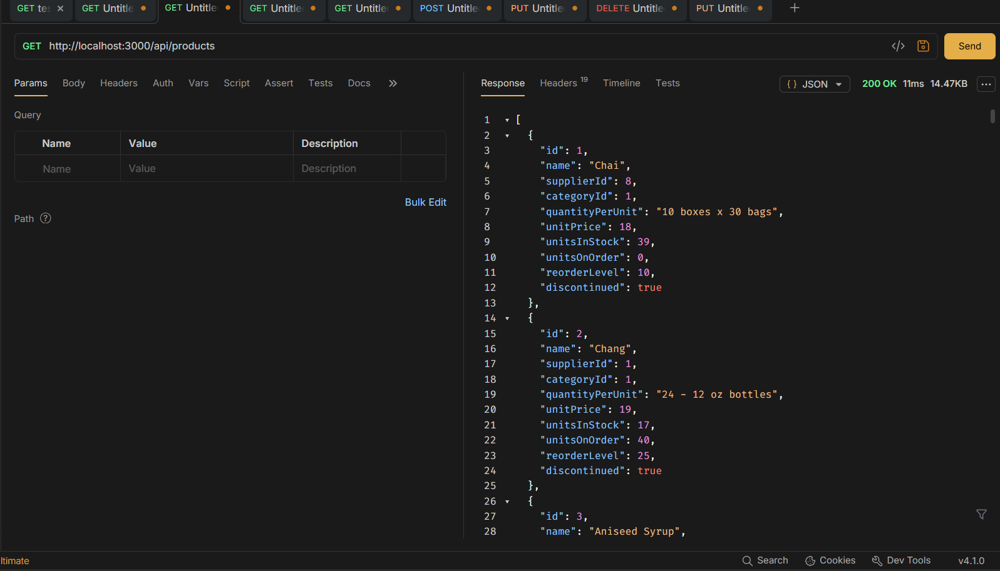
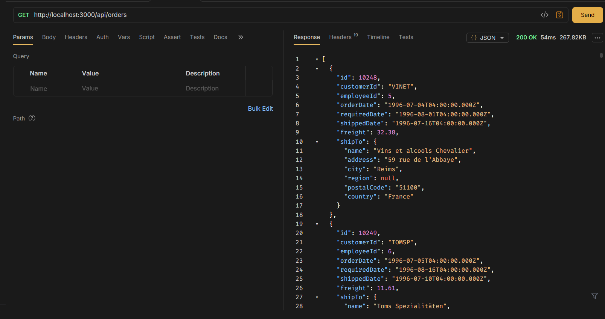
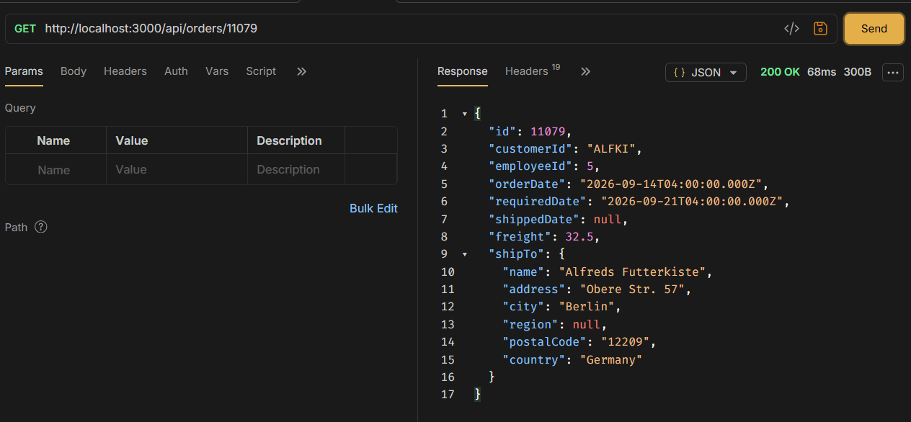
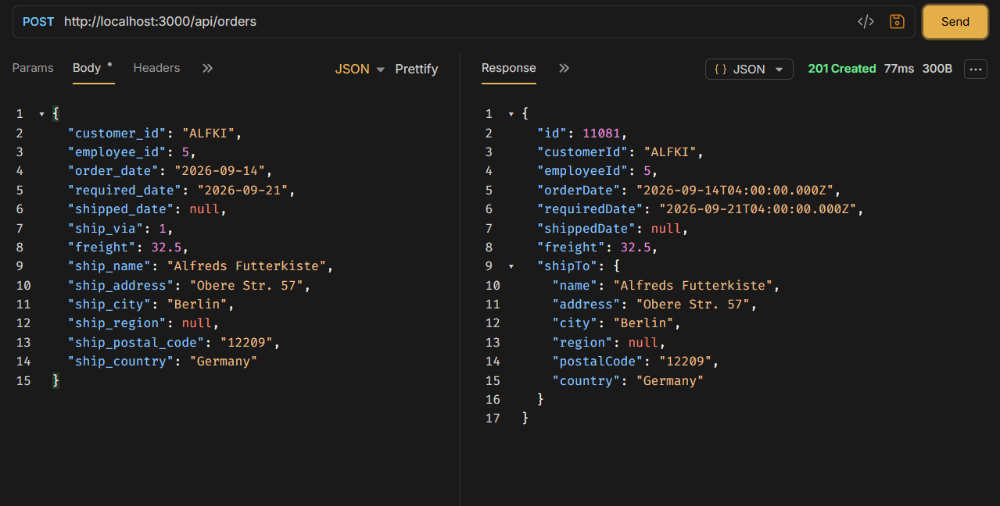
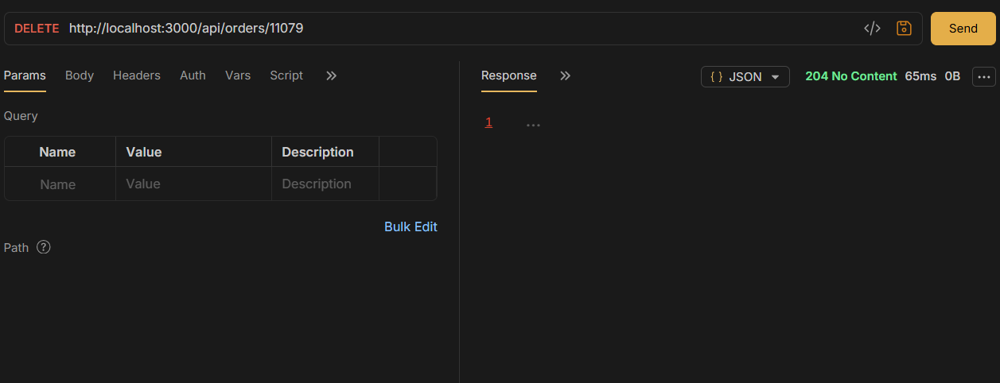

#Nombre: Oscar Ezequiel Ariscain Robles 

# API de Órdenes de Venta - Northwind (PostgreSQL)

API REST construida con Node.js, Express y PostgreSQL para consultar datos de la
base de datos Northwind (clientes, empleados, productos y órdenes). Incluye
documentación interactiva con Swagger.

## Tecnologías

- Node.js / Express
- PostgreSQL (`pg`)
- Swagger (`swagger-jsdoc` + `swagger-ui-express`)
- Helmet (seguridad de cabeceras HTTP)
- CORS
- dotenv
- JWT (autenticación)
- nodemon (desarrollo)

## Requisitos previos
(tener descargado la version mas actual v.18 )

- Node.js instalado (v18 o superior recomendado)
- PostgreSQL instalado y corriendo
- Base de datos Northwind restaurada en PostgreSQL

## Instalación

1. Clona el repositorio:

   ```bash
   git clone https://github.com/Twokarma/1_parcialde-Tecno2.git
   cd api-northwind
   ```

2. Instala las dependencias:

   ```bash
   npm install
   ```

3. Copia el archivo de variables de entorno de ejemplo y complétalo con tus
   datos de conexión:

   ```bash
   cp .env.example .env
   ```

   Variables disponibles:

   | Variable          | Descripción                                              | Valor por defecto |
   |-------------------|-----------------------------------------------------------|--------------------|
   | `DB_HOST`         | Host del servidor PostgreSQL                              | `localhost`        |
   | `DB_PORT`         | Puerto de PostgreSQL                                       | `5432`             |
   | `DB_USER`         | Usuario de PostgreSQL                                      | `postgres`         |
   | `DB_PASS`         | Contraseña del usuario                                     | -                  |
   | `DB_NAME`         | Nombre de la base de datos                                 | `northwind`        |
   | `NODE_ENV`        | Entorno de ejecución (`development` / `production`)        | `development`      |
   | `PORT`            | Puerto donde corre el servidor Express                     | `3000`             |
   | `JWT_SECRET`      | Clave secreta para firmar los tokens JWT                   | -                  |
   | `JWT_TIME_EXPIRE` | Tiempo de expiración de los tokens (ej. `1h`, `30m`, `7d`)  | `1h`               |

   > **Nota:** Swagger (`/api-docs`) solo se activa cuando `NODE_ENV` no es
   > `production`, para no exponer el detalle de los endpoints en un entorno
   > real.

4. Inicia el servidor en modo desarrollo:
No olvidar tener las librerias correctas para el correcto funcionamiento

   ```bash
   npm run dev
   ```

   O en modo producción:

   ```bash
   npm start
   ```

El servidor quedará disponible en `http://localhost:3000` (o el puerto que
hayas configurado).

## Documentación de la API (Swagger)

Con el servidor corriendo en un entorno distinto a `production`, la
documentación interactiva está disponible en:

```
http://localhost:3000/api-docs
```

Desde ahí puedes ver todos los endpoints disponibles, sus parámetros y
respuestas, y probarlos directamente con el botón "Try it out".

## Endpoints principales

Todas las rutas están montadas bajo el prefijo `/api`.

| Método | Ruta                     | Descripción                      |
|--------|--------------------------|-----------------------------------|
| GET    | `/api/customers`         | Lista de clientes                 |
| GET    | `/api/customers/{id}`    | Cliente por id (ej. `ALFKI`)      |
| GET    | `/api/employees`         | Lista de empleados                |
| GET    | `/api/employees/{id}`    | Empleado por id                   |
| GET    | `/api/products`          | Lista de productos                |
| GET    | `/api/products/{id}`     | Producto por id                   |
| GET    | `/api/orders`            | Lista de órdenes (admite `customer_id`, `employee_id` como filtros) |
| GET    | `/api/orders/{id}`       | Orden por id                      |

> El `customer_id` en Northwind es un código de texto de 5 caracteres
> (ej. `ALFKI`, `ANATR`), no un número.

## Pruebas con Bruno / Postman

Puedes probar los endpoints con cualquier cliente HTTP (Bruno, Postman, curl,
etc.) apuntando directamente a las rutas, por ejemplo:

```
GET http://localhost:3000/api/customers/ALFKI
GET http://localhost:3000/api/orders
```

## Estructura del proyecto

```
├── src/
│   |
│   ├── config/
│   │   ├── db.js           # Conexión a PostgreSQL (pool)
│   │   └── swagger.js      # Configuración de Swagger
│   |── controllers/          # Lógica de cada endpoint
│   │   │──customer.controller.js
│   │   │──employee.controller.js
│   │   │──order.controller.js
│   │   │──product.controller.js
│   └── dto/                 # Data Transfer Objects
│   │   │──customer.dto.js
│   │   │──employee.dto.js
│   │   │──order_detauil.dto.js
│   │   │──order.dto.js
│   │   │──product.dto.js
│   ├── middlewares/             # Funciones intermedias (autenticación, validaciones, etc.)
│   │   │──auth.middlewares.js
│   ├── models/             # Entidades / acceso a datos (queries a PostgreSQL)
│   │   │──customer.entity.js
│   │   │──employee.entity.js
│   │   │──order_detail.entity.js
│   │   │──order.entity.js
│   │   │──product.entity.js
│   ├── routes/              # Definición de rutas + documentación JSDoc
│   │   │──customer.js
│   │   │──employee.js
│   │   │──order.js
│   │   │──product.js
│   ├── services/             # Lógica de negocio (entre el controller y el model)
│   │   │──customer.service.js
│   │   │──employee.service.js
│   │   │──order.service.js
│   │   │──product.service.js
│   ├── tests/         #  Pruebas automatizadas (Jest + supertest)
│   │   │──customer.reoutes.test.js
│   │   │──employee.routes.test.js
│   │   │──order.routes.test.js
│   │   │──product.routes.test.js
|
|── app.js              # Configuración de Express y montaje de rutas
│── server.js           # Punto de entrada (arranque del servidor)
├── .env.example
├── .gitignore
└── package.json
```

## Manejo de errores

- **404**: cuando la ruta solicitada no existe o el recurso no se encuentra.
- **500**: error interno (por ejemplo, fallo de conexión a la base de datos o
  error en una consulta). Los detalles internos no se exponen al cliente; se
  registran en la consola del servidor.

## Endpoints

### Clientes
```
GET /customers
```

**Ejemplo de respuesta**




### Cliente por ID
```
GET /customers?search=ALFKI
```

**Ejemplo de respuesta**




### Empleados
```
GET /employees
```

**Ejemplo de respuesta**




### Productos
```
GET /products
```

**Ejemplo de respuesta**




### Órdenes
```
GET /orders
```

**Ejemplo de respuesta**




### Consultar una orden
```
GET /order/{id}
```

**Ejemplo de respuesta**




### Crear una orden
```
POST /order
```

**Ejemplo de respuesta**




### Eliminar una orden
```
DELETE /order/{id}
```

**Ejemplo de respuesta**

